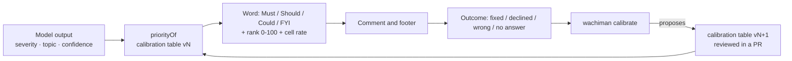

# A calibrated finding priority instead of the Important/Nit word

- **Status:** proposed (2026-11-18). Tracker: [NIW2-873](https://linear.app/niway/issue/NIW2-873/wachiman-a-calibrated-finding-priority-must-should-could-fyi-instead); measurement: [NIW2-874](https://linear.app/niway/issue/NIW2-874/wachiman-measure-what-happens-to-each-finding-per-severity-confidence).
- **ADRs:** [the priority word is derived from a calibration table](../adr/0059-the-finding-priority-is-derived-from-a-calibration-table.md) (new; supersedes [ADR 0030](../adr/0030-review-result-2-carries-verification-and-origin-with-an-explicit-downgrade-to-1.md) decision 7 and amends the word in the inline severity cell of [ADR 0055](../adr/0055-the-review-comment-is-rendered-in-fixed-slots-from-a-view-model.md) decision 8).

## Summary (one minute)

Every finding opens with a word derived from severity alone: Important for Blocker and Fix, Nit
for Consider and Info. It was copied from Claude Code's review format, whose only stated reason is
keeping pre-existing bugs from looking like the author's fault. In our own reviews the word is
wrong where it matters: a high-confidence Consider is fixed 95% of the time, more than a Fix, and
still reads as "Nit". This spec replaces the word with a **priority** (Must, Should, Could, FYI)
that the engine derives from severity, confidence and topic through a versioned calibration table,
shows each comment's measured rate beside it, and adds a command that recalibrates the table from
recorded outcomes. The model never picks the priority. The loop's stop rule and the review cost do
not change in this version.

<!-- visual: priority-grid -->

## What changes

| Thing | Today | After |
| --- | --- | --- |
| Headline word | `Nit` or `Important`, from severity only | `Must`, `Should`, `Could` or `FYI`, from severity × confidence × topic group |
| Where the word comes from | `tierWord` in code | `priorityOf(finding, table)`; the table is versioned data shipped with the engine |
| Confidence in the comment | A meter, not used for ranking | Still the meter; it now moves the priority, and the cell's measured rate shows beside it |
| Pre-existing | Folded into the word | Its own origin badge, beside any priority |
| Result `/2` | `tier: Important \| Nit \| Pre-existing` | Adds `priority` and `rank`; `tier` stays, deprecated, until `/3` |
| Calibration | None | `wachiman calibrate` prints outcome rates per cell and proposes the next table |
| Stop rule | Severity | Severity, unchanged |

## Decisions

| # | Decision | Why | ADR |
| --- | --- | --- | --- |
| 1 | The headline word is a priority derived by the engine, never chosen by the model | The same reasoning as ADR 0031 for the risk-map level (a model-picked level is unreliable), applied here to findings; confidence already separates outcomes | 0059 (new) |
| 2 | Four words: Must, Should, Could, FYI | Two words cannot hold "almost always fixed but not blocking"; "Nit" already means "ignore" | 0059 |
| 3 | The priority comes from a versioned table keyed by severity × confidence, with topic group (defect, quality, question) as a third key only once a split cell is measured; the rank (0–100) is the lower end of the cell's judged interval, sorts findings within a word, is stored but never displayed, and never gates anything | A table scales by data, not by code; ADR 0031 rejected a number because thresholds turn it into a gate, so the rank stays a sort key | 0059 |
| 4 | Table v1 is seeded from the severity × confidence rows of the sample below: Blocker high/medium → Must, Fix high/medium → Should, Consider high → Should, Consider medium and low → Could, any low-confidence Blocker or Fix → Could, Info → FYI. A cell not measured under decision 12 keeps its seed and says so | Only what the sample shows; the topic split (defect Considers fixed 61%, below tests and docs) is not enough to seed by topic; "Could" is the default where nothing is known | 0059 |
| 5 | Each comment shows what its cell's number measures and on how much: `fixed 95% · n 56 · 12 PRs` | Highlights confidence and makes every review a data point, without calling a fix rate "should act" | 0059 |
| 6 | The table is fitted to **warranted action**: a sample of findings judged by a person who does not see the displayed word. Fix, decline and no-answer rates are reported beside it, never fitted | A fix (above all an agent's) measures compliance; the label would otherwise learn its own effect | 0059 |
| 7 | A new table ships only in a reviewed PR and stays frozen for the release | Prevents the label from confirming itself (higher word → more fixes → higher word) | 0059 |
| 8 | `tier` stays in `/2` as deprecated, computed as today; `priority` and `rank` are added | `/2` consumers keep working (ADR 0030 reopen condition: deliberate wire change) | 0059 |
| 9 | The loop's stop rule keeps reading severity | Measure first how many Should findings a loop leaves open before letting the word add rounds | — |
| 10 | A rate can raise a priority, never lower it below a floor set by severity and topic: Blocker is Must, Fix on a defect or security topic is Should | A rare severe defect must never rank under a frequent cleanup | 0059 |
| 11 | Each cell records the model family and prompt version it was measured on; a review on another configuration shows `not measured for this configuration` and uses the seed | A cell's contents change when the model or prompt changes | 0059 |
| 12 | A cell counts as measured only when n ≥ 20 from at least 5 PRs and the lower end of its 90% Wilson interval clears the band; a word changes only when the interval moves past the band edge | Twenty correlated outcomes near an edge would flip words between releases | 0059 |
| 13 | The trial is an A/B in the owner's repositories: each PR is assigned the old word or the priority at random, recorded in the result, for at least two weeks | The only way to tell the word's effect from the findings' | — |
| 14 | Pre-existing is an origin badge beside the priority, never a priority | Keeps Claude Code's one stated reason (a bug the PR did not introduce is not the author's fault) without hiding its severity | 0059 |
| 15 | The cell rate is rendered in the finding's body, never on the title line | `precision.ts` reads confidence anchored to the end of the title line | 0059 |

## Layers

| # | What it builds | Criteria | Risk | Depends on |
| --- | --- | --- | --- | --- |
| 1 | `priority` and `rank` on findings, `priorityOf` with floors, table v1 as data with provenance, title and footer show the word and the cell rate, origin badge, `tier` deprecated, A/B assignment | AC1–AC5, AC10, AC11, AC13, AC15 | 🟡 Medium | — |
| 2 | `wachiman calibrate`: outcome rates per cell from local history, verdicts and PR threads; a blind judging sample; proposes table vN+1 as a diff | AC6–AC8, AC12, AC14 | 🟡 Medium | 1 |
| 3 | Prompt: the test that separates Fix from Consider, measured on the benchmark before and after | AC9 | 🟢 Low | 2 |

## Open questions

1. **Size and pace of the blind judging sample.** Default: 40 findings per release, stratified over
   the eight severity × confidence cells that occur (about five each), unanswered findings included,
   judged by the owner with the word hidden ("would you act on this?"). Judgements accumulate across
   releases, so a cell reaches decision 12 after about four releases; cells whose fix rates disagree
   most with their seed are judged first. Revisit after the first run of NIW2-874.
2. **Bands from rank to word.** The rank is 100 × the lower end of the cell's 90% Wilson interval
   on the judged "would act" proportion. Default: Should 60 and above, Could 25–59, FYI below 25. Must is
   not a band: it is every Blocker at high or medium confidence, whatever its rate. A Blocker at low
   confidence is already posted as a question (ADR 0027) and is Could.
3. **Should a Could be skipped by agents?** Claude Code's write-up notes that an agent fixes every
   nit, which costs a commit and a round. A later rule could tell agents to answer Could without
   fixing it. Out of this version; the data from layer 2 decides.

## Out of scope

- Changing the stop rule or the loop budget.
- A per-repository table before its cells reach the minimum sample.
- Dropping or capping low-priority findings before posting.
- Any change to what the model is asked to find.

## Failures this must protect against

- A Blocker at high or medium confidence shown as anything but Must.
- A low-confidence Fix or Blocker (already posted as a question, ADR 0027) shown above Could.
- A cell with n below the minimum shown with a rate as if it were measured.
- `tier` changing value for an existing `/2` consumer.
- A pre-existing Blocker losing its origin badge or its Must.
- The table changing mid-release because `calibrate` ran.
- Agent fixes inflating a cell until it climbs a band.
- A fix rate shown or used as "the author should act".
- Unanswered findings dropped from the denominator, hiding the ones nobody wanted.
- A table measured on one model or prompt applied to another as if measured.
- A cell flipping words between releases on noise near a band edge.
- A frequent, cheap cleanup cell ranked above a defect or security Fix.

## Acceptance criteria

- [ ] **AC1** `priorityOf` returns Must for every Blocker at high or medium confidence, Could at low, and the v1 table maps Consider · high to Should, Consider · medium and low to Could, and every Info to FYI (unit tests over every cell).
- [ ] **AC2** In the inline finding of ADR 0055, the severity cell reads `🟡 Consider` with the word `Should`, and the signature line reads `Wachiman · should`; the review body's `… via …` footer is unchanged; golden Markdown files updated.
- [ ] **AC15** The cell rate appears only in the finding body; `parseLabel` in `src/precision.ts` still reads severity, topic and confidence from every golden file.
- [ ] **AC3** A measured cell shows `fixed 
% · n <n> · <k> PRs`; a cell below the rule of decision 12 shows `not yet measured`.
- [ ] **AC4** `/2` output keeps `tier` with today's values and adds `priority` and `rank`; the JSON schema validates both old and new files.
- [ ] **AC5** Pre-existing findings show the origin badge and keep their priority.
- [ ] **AC6** `wachiman calibrate` prints, per cell, n, fixed %, declined %, wrong %, unanswered %, split by owner and agent.
- [ ] **AC7** `wachiman calibrate --propose` writes the next table as a file diff and changes nothing the engine reads until it is committed.
- [ ] **AC8** Running `calibrate` on the local history of one repository reproduces the sample table below within one percentage point.
- [ ] **AC9** The prompt change is merged only if, on the benchmark, the share of Fix among findings later fixed rises and the share of Fix later declined does not exceed one third (ADR 0003 reopen condition).
- [ ] **AC10** No finding gets a priority below its floor: every Blocker at high or medium confidence is Must, every Fix on a defect or security topic at high or medium confidence is at least Should (property test over all cells and rates).
- [ ] **AC11** A review whose model family or prompt version differs from the cell's provenance shows `not measured for this configuration` and the seed word.
- [ ] **AC12** `calibrate` marks a cell measured only under decision 12, and a word moves only when the interval crosses the band edge (unit tests at the edges).
- [ ] **AC13** With the trial on, each PR's result records `arm: word | priority`, assigned at random, and the comment renders accordingly.
- [ ] **AC14** `calibrate --judge` draws the blind sample (unanswered included), hides the word, and stores each judgement; the proposed table is fitted to those judgements, with fix and decline rates reported beside them.

---

## Evidence: the sample behind table v1

Five days of remote reviews (2026-11-14 to 2026-11-18) on one private product repository, 63
pull requests, counts only. "Fixed" and "declined" come from the author's reply on each thread;
findings with no reply are excluded from the rate.

| Severity · confidence | Answered | Fixed | Declined |
| --- | --- | --- | --- |
| Consider · high | 56 | 95% | 5% |
| Consider · medium | 96 | 71% | 29% |
| Consider · low | 25 | 56% | 44% |
| Fix, any confidence | 11 | 73% | 27% |

By topic group, Consider findings about defects (bug, security, perf) were fixed 61% of the time,
tests 82%, docs and cleanup 80%. The model labelled 11 of 231 remote findings Fix, and 52 Consider
findings were topic `bug`.

**Limits.** One repository, one model configuration, mostly agent authors. "Fixed" is a reply that
says so, not a checked commit, and it measures compliance, not whether acting was warranted.
Unanswered findings are excluded. That is why v1 is only a seed, decision 6 fits the table to blind
judgements, and layer 2 exists. The design was attacked before review; its weak points and answers
are in "Weak points and answers" below.

## Weak points and answers

Attacked by a second model on another provider with only the claim and the facts.

| Weak point | Answer |
| --- | --- |
| A fix rate measures compliance, not whether to act | Decision 6: fit to blind judgements; show `fixed` for what it is |
| A table from one repository is not portable | Decision 11: provenance per cell; other configurations fall back to the seed |
| 20 outcomes is not precision; edges flip | Decision 12: 5 PRs minimum, Wilson interval, hysteresis |
| The word changes the behaviour it learns from | Decisions 6 and 13: blind judgements and an A/B arm |
| A cell average hides stakes | Decision 10: severity and topic floors; a rate only raises |
| "No added rounds or cost" was a code property | Narrowed to "no extra model call"; rounds measured in the A/B |

## Why not keep Claude Code's three words

Claude Code tags each finding Important, Nit or Pre-existing; its write-up gives one reason, "so a
bug the PR didn't introduce doesn't look like the author's fault"
([Solving code review at Anthropic](https://claude.dev/blog/solving-code-review-at-anthropic/)).
Their pipeline drops style, diagnostics and cleanup findings and caps nits before posting, so its
Nit is a small residue. Wachiman posts every Consider, so the same word covers most of what we
post, including findings authors fix almost always. The pre-existing reason stays valid: it moves
to its own badge (decision 14). The same write-up sorts every comment by how the author responded
(fixed, wrong, intentional, didn't matter); `calibrate` uses the same outcomes.

## State of the art

| Tool | How it ranks | Derived or chosen |
| --- | --- | --- |
| [CodeQL](https://codeql.github.com/docs/writing-codeql-queries/metadata-for-codeql-queries/) | `problem.severity` and `precision` kept apart; both decide display; `security-severity` from CVSS | Derived from query metadata |
| [SARIF 2.1.0](https://docs.oasis-open.org/sarif/sarif/v2.1.0/errata01/os/sarif-v2.1.0-errata01-os-complete.html) | `level` category plus `rank` 0–100 for priority within it | Emitted by the tool |
| [Semgrep](https://docs.semgrep.dev/contributing/contributing-to-semgrep-rules-repository) | Severity beside `confidence`, `likelihood`, `impact` | Chosen by the rule author |
| [SonarQube](https://docs.sonarsource.com/sonarqube-server/latest/user-guide/rules/overview/) | Software quality × impact severity, from impact and likelihood | Assigned per rule |
| [CodeRabbit](https://docs.coderabbit.ai/change-stack/findings.md) | Type (Nitpick is a type), severity, category, effort; "read the labels together" | Chosen by the model |
| [Conventional Comments](https://conventionalcomments.org/) | Label plus decoration: blocking, non-blocking, if-minor | Chosen by the reviewer |
| [Google Tricorder](https://www.cs.umd.edu/class/spring2019/cmsc414/papers/tricorder-building-a-program-analysis-ecosystem.pdf) | Analyzers demoted when developers take no positive action on too many findings | Calibrated from outcomes, per analyzer |

Mature tools keep confidence apart from priority, and only a few derive the headline. None prints a
per-finding priority calibrated from outcomes; layer 2 is new ground and is measured as such.

## Expected impact (for the release notes)

The change is cheap to build: the word only renders titles, needs no extra model call, and the stop
rule reads severity. The expected gain is triage: findings authors act on almost always stop reading as Nit, a Could is
visibly optional, and every comment carries the rate it is ranked by, so each review adds data. Authors may
spend more on a finding that now reads Should, so rounds and commits after a PR opens are measured
in the A/B against the NIW2-874 baseline and reported, not assumed.
