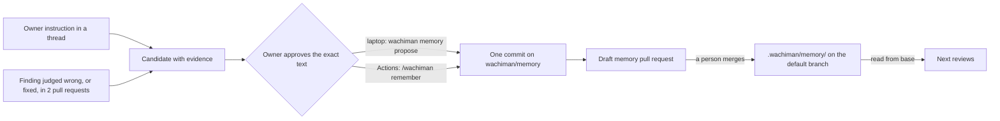

# Design: repository memory kept in git, proposed from review feedback and merged by a person

- **Status:** proposed (2026-11-18). Tracker: [NIW2-867](https://linear.app/niway/issue/NIW2-867/wachiman-repository-memory-kept-in-git-proposed-from-review-feedback). Nothing in this spec is implemented.
- **ADRs:** [repository memory lives in `.wachiman/memory/` and changes only through one draft pull request](../adr/0056-repository-memory-lives-in-wachiman-memory-and-changes-only-through-one-draft-pull-request.md), [a memory exception is applied after discovery and every muted finding is shown](../adr/0057-a-memory-exception-is-applied-after-discovery-and-every-muted-finding-is-shown.md).

## Summary (one minute)

Wachiman keeps a memory of what a repository's owner has taught it: how code is written there
(conventions) and which findings are not wanted (exceptions). The memory is Markdown files in the
reviewed repository, under `.wachiman/memory/`, read from the base commit. Wachiman proposes an
entry when the owner gives an instruction in a thread, judges a finding wrong with a reason, or
fixes the same kind of finding in two pull requests. The owner approves each entry, on the laptop
through their coding agent or in the pull request with `/wachiman remember`. Every change reaches
the default branch through one draft pull request that a person merges. Whether memory lowers
review noise without hiding real bugs is a hypothesis; the pilot on kaipu-record measures it.



## What changes

| Thing | Today | After |
| --- | --- | --- |
| What the reviewer knows about the repository | `.github/wachiman.md`, root `CLAUDE.md` and `AGENTS.md`, pasted whole | The same, plus `.wachiman/memory/index.md` and the area files whose glob the diff touches |
| A finding the owner does not want | Reported again on the next pull request | The owner's instruction becomes a proposed exception; once merged, the finding is listed under "Muted by memory" and not posted |
| A fix the owner keeps making | Nothing is learned | After two pull requests, a convention is proposed |
| Who writes memory | Nobody | Wachiman writes one commit per approved entry to the branch `wachiman/memory`; a person merges |
| The coding agent on the laptop | Fixes every finding | Fixes what is mechanical, asks the owner about findings that depend on intent, and asks before proposing memory |
| Memory size | Not applicable | A line budget; over it, the review says so and `wachiman memory check` fails |
| Evidence that memory helps | None | Each run records comment outcomes and muted findings; a replay compares runs with and without memory |

## Decisions

| # | Decision | Why | ADR |
| --- | --- | --- | --- |
| 1 | Memory is Markdown under `.wachiman/memory/` at the repository root: `index.md` (always loaded), area files (loaded when the diff touches their glob), `archive.md` (never loaded). The path is fixed, not configurable | Wachiman now runs on the laptop and has `.wachiman.yml` at the root; `.github/` is a GitHub convention. A fixed path cannot be repointed by a pull request | 0056 (new), supersedes the location in 0006 |
| 2 | Memory is read only from the base commit. Each run records the memory revision and the files it loaded. An incremental run applies the current base memory to the new diff only | A pull request cannot rewrite its own rules; the record makes a review reproducible | 0056, reuses 0006 and 0049 |
| 3 | An entry has a kind (`convention` or `exception`), a path scope, a reason, an evidence list and, when it depends on a fact about the code, a `holds while` line naming the paths that fact lives in. Its id is a digest of its text | Evidence and scope are what keep a memory from becoming garbage; the id ties an approval to an exact text | 0056 |
| 4 | Conventions go into the review prompt. Exceptions never do: findings are discovered without them, then each exception is matched against the candidates, and a match is moved to a "Muted by memory" list in the summary with the entry id | An exception in the discovery prompt can stop a real bug from ever being generated, and nothing would show it | 0057 (new) |
| 5 | An exception cannot mute a finding at a blocking severity or with the security topic. The engine enforces it, not the prompt | The owner's rule: memory never hides a bug | 0057 |
| 6 | Three signals create a candidate: an explicit operator instruction with a reason (enough alone); a finding judged wrong or intentional with a reason; a finding fixed. The last two need `memory.min_evidence` (default 2) from different pull requests. A fix only supports a convention. Reactions and silence are never evidence | One exception must not become a rule; the pilot's replies are mostly "Fixed in", so fixes must count for something, but only for what they show | 0056 |
| 7 | The model drafts the entry from the code and the owner's intent. The owner approves that exact text; the commit carries the same digest. Redrafting after approval is not allowed | A raw "no, not important" is not a rule; an approval must be of what gets written | 0056 |
| 8 | One write path: one commit per entry on the branch `wachiman/memory`, in one draft pull request titled `chore(wachiman): memory`. Never a force-push, only paths under `.wachiman/memory/`, "recorded" is said only after the push succeeds | The owner sees every change; anyone can check the branch out and refine it | 0056, supersedes the capture in 0007 |
| 9 | On the laptop, `wachiman memory propose <id>` writes with the developer's own git credentials. In Actions, the operator's `/wachiman remember` starts a separate job with `contents: write` and `pull-requests: write`; the engine writes, the model has no credentials, the review job stays read-only | The laptop needs no new permission, so the pilot can start there; the write permission is confined to one job only the operator can start | 0056 |
| 10 | Approving memory and dismissing the current finding are separate. In the pull request where the operator gave the instruction, that finding is dismissed at that code state and comes back if the cited code changes. Wachiman replies in the thread and never resolves it | Memory is not active until merged; a dismissal must not outlive the code it judged. Reuses the rule that only the operator resolves | reuses 0008 |
| 11 | Budget: 150 lines for `index.md`, 400 lines loaded per review, both set in `.wachiman.yml`. Over budget, the review loads the most specific globs first, names what it left out and says so | Memory can grow without limit only if it stays light for each review | 0056 |
| 12 | Hygiene is suggested, never applied: possible duplicates and contradictions, entries whose `holds while` paths the diff touches, entries not used in `memory.archive_after_days` (default 90). An archive suggestion moves the entry to `archive.md` | The team tunes the memory; Wachiman points at likely problems | 0056 |
| 13 | `wachiman init` writes an agent block into the repository's agent instruction file: fix mechanical findings, ask the owner about findings that depend on intent, tell the owner when a finding could become memory and ask, and what belongs in memory | The owner does not read the review comments; their agent does, and it must ask | — |
| 14 | Every run records each comment's outcome (fixed, wrong, intentional, not important, unjudged) and the findings memory muted. `wachiman memory report` prints them with memory size and never-used entries | The hypothesis needs a measure; the owner asked for a control of how memory growth changes the reviews | — |
| 15 | Hand-written instruction files win over memory when they disagree, and the review says which entry lost | The owner's own words outrank what was learned | reuses 0006 |

## Layers

| # | What it builds | Criteria | Risk | Depends on |
| --- | --- | --- | --- | --- |
| 1 | Entry format, parser, base-commit reader, glob selection, budget, `wachiman memory check` | AC1, AC2, AC3, AC4, AC10 | 🟡 Medium | — |
| 2 | Review uses memory: conventions in the prompt, exceptions after discovery, "Muted by memory", revision in the record | AC5, AC6 | 🔴 High | 1 |
| 3 | Laptop capture: candidates in `loop` and the local history, `wachiman memory propose`, the draft pull request | AC7, AC8 | 🟡 Medium | 1 |
| 4 | The agent block written by `wachiman init` | AC12 | 🟢 Low | 3 |
| 5 | Actions capture: the suggestion in the thread reply, `/wachiman remember`, the write job in `review.yml` | AC9 | 🔴 High | 3 |
| 6 | Hygiene suggestions: out of date, duplicates, archive | AC11 | 🟡 Medium | 2 |
| 7 | Measurement: outcomes per comment, `wachiman memory report`, the replay protocol and its first run | AC13, AC14 | 🟡 Medium | 2 |

Layers 1 to 4 are enough to use memory on kaipu-record from the laptop, with no new permission.

## Open questions

1. **`.wachiman/memory/` or `.github/wachiman-memory/`.** The owner's first choice was the second
   and they asked for a better place if one exists. Default: `.wachiman/memory/`. The strongest
   argument against it: the focus file stays at `.github/wachiman.md`, so Wachiman's files live in
   two places until that file moves.
2. **Replies written by an agent on the owner's behalf.** In the pilot most replies are an agent's.
   Default: they create candidates, labelled as agent-written in the evidence, and the owner's
   approval of the entry is what counts.
3. **How an exception is matched to a candidate.** Default: the verifier call does it when
   verification is on; otherwise one small model call per review that has both candidates and
   exceptions in scope. The plan measures its cost.
4. **Branch protection on the default branch.** With one maintainer and required reviews, the
   memory pull request needs the same approval as any other. Default: no special path.

## Out of scope

- A hosted memory store, or memory shared across repositories.
- Learning from reactions or from silence.
- Resolving threads.
- Turning a lesson into a lint rule or a test. When an entry describes something a tool can
  enforce, the suggestion says so; writing the check is the owner's work.
- Memory from engine-checked contracts, the open design in
  [pull request 90](https://github.com/niway-dev/wachiman/pull/90). It can become a fourth source
  of candidates later.
- Renaming kaipu-record's `.github/agent-review.md` to `.github/wachiman.md`. It is a
  prerequisite of the pilot (the old name is no longer read after v1.13.0) and belongs to that
  repository.

## Failures this must protect against

These are risks, not observed incidents in Wachiman. The ones marked (other tools) were reported by
users of other products; sources are in the detail below.

- An exception whose premise stopped being true hides a real bug: "these handlers get validated
  input" after a new caller bypasses the gateway.
- An exception mutes a blocking or security finding.
- One reply, or two replies by the same agent repeating the same mistaken explanation, becomes a
  rule.
- A cosmetic rewrite removes the cited text, the finding is marked fixed, and the tool learns from
  a fix that did not happen.
- The owner approves one text and a different text is committed.
- An approval is given by clicking through, without reading (other tools).
- Memory from one area is applied to another (other tools).
- Two entries contradict each other and the model picks one silently (other tools).
- Memory grows until nobody reads it, or entries nobody uses stay forever (other tools).
- A frequently used entry is wrong and is never questioned because it is never "unused".
- A dismissal in one pull request survives a later push that makes the finding true.
- The laptop and the Actions job write to the memory branch at the same time and one entry is lost
  or duplicated.
- Someone who is not the operator triggers a write.
- A broad diff matches more memory than the budget and the review silently drops rules.
- The replay reports a memory effect that is only run-to-run variation, or passes its guardrail
  while losing a bug the author had not fixed.

## Acceptance criteria

- [ ] **AC1** With no `.wachiman/memory/` folder, a review's prompt and output are byte-identical to today's.
- [ ] **AC2** Memory is read only from the base commit. An entry added or changed in the pull request under review has no effect on that review.
- [ ] **AC3** A review loads `index.md` plus only the area files whose glob matches a changed path, and its record names the memory revision and the files loaded.
- [ ] **AC4** When the loaded memory would exceed the budget, the review loads the most specific files first, names the files it left out, and says the memory is over budget.
- [ ] **AC5** An exception entry never reaches the discovery prompt. A finding it mutes is listed under "Muted by memory" with the entry id.
- [ ] **AC6** An exception cannot mute a finding at a blocking severity or with the security topic. A test proves the finding is posted.
- [ ] **AC7** A candidate found by the tool is not proposable until it has `memory.min_evidence` pieces of evidence from different pull requests. An explicit operator instruction is proposable with one.
- [ ] **AC8** `wachiman memory propose <id>` adds exactly the entry text the developer was shown, as one commit on the branch `wachiman/memory`, and opens or updates one draft pull request. It never force-pushes and never touches a path outside `.wachiman/memory/`.
- [ ] **AC9** In Actions, an operator's `/wachiman remember` runs a separate job that writes the same commit. The review job keeps `contents: read`. A comment from anyone else writes nothing. The thread gets a reply and is not resolved.
- [ ] **AC10** `wachiman memory check` exits non-zero on a malformed entry, a glob that matches no file, or a budget overrun, and prints each problem with its file and line.
- [ ] **AC11** A review of a diff that touches a path an entry names in `holds while` says that entry may be out of date.
- [ ] **AC12** `wachiman init` writes the agent block into the repository's agent instruction file, and re-running it does not duplicate the block.
- [ ] **AC13** `wachiman memory report` prints, per period: comments by outcome (fixed, wrong, intentional, not important, unjudged), findings muted by memory, memory size, and entries never used.
- [ ] **AC14** The replay protocol is written down and run once on kaipu-record: memory frozen before the evaluated commits, three runs per arm, results with their spread.

---

## Detail

### The files

```text
.wachiman.yml                 # settings, including memory.*
.wachiman/memory/
  index.md                    # always loaded: repository-wide entries, and a table glob -> file
  apps-desktop.md             # loaded when the diff touches its glob
  packages-ui.md
  archive.md                  # never loaded
```

A repository starts with `index.md` alone. An area file is created when the index passes its
budget or when entries share a glob. `index.md` lists each area file with its glob; a file not
listed there is not loaded and `wachiman memory check` reports it.

### An entry

```markdown
### 4c1e9a2 ADR wording edits do not need a status or date bump

- kind: exception
- scope: docs/adr/**
- rule: Only a change to the Decision section requires updating the status line. Do not report a
  stale date on other edits.
- why: ADRs version themselves when a decision changes, not on every wording edit.
- evidence:
  - 2026-11-18 operator instruction, pull request 709, thread on docs/adr/0031-camera-parts.md
- added: 2026-11-18
```

The example is illustrative. `holds while` is required for an exception whose reason is a fact
about the code ("this caller already validates") and omitted for a preference, as here.

### Settings

```yaml
memory:
  min_evidence: 2          # tool-found candidates; an explicit instruction always needs 1
  max_index_lines: 150
  max_loaded_lines: 400
  archive_after_days: 90
```

Read from the base commit, as the other keys are
([model and effort in `.wachiman.yml`](../adr/0049-model-and-effort-in-wachiman-yml-read-from-the-base-commit.md)).
The budget numbers are a starting point with no evidence behind them; the pilot adjusts them.

### What belongs in memory

The agent block and the drafting prompt carry the same guideline.

- Belongs: how code is written here (readable before terse), what a test must have, how documents
  and ADRs are kept, behaviour that is intentional and looks like a bug.
- Does not belong: the details of one feature, a one-time exception, the temporary state of a
  migration, anything a formatter or linter can enforce, anything already in a hand-written
  instruction file.

### The agent block

Written by `wachiman init` between markers, so a re-run replaces it. In substance:

1. Fix the findings that are mechanical.
2. For a finding whose fix depends on what the owner intends, do not guess: after fixing the rest,
   ask the owner, saying what you would do and why you are asking.
3. When `wachiman loop` lists a memory candidate, or the owner says a finding should not come back,
   show the proposed entry and ask. On yes, run `wachiman memory propose <id>`.
4. What belongs in memory, as above.

### Where each weak point went

The recommendation was attacked by a second model that saw only the claim and the facts
(2026-11-18). All eight weak points it raised were judged real.

| Weak point | Answer |
| --- | --- |
| Memory in the discovery prompt can stop a bug from being generated | Decision 4 and 5: exceptions are applied after discovery, muted findings are shown |
| A two-run replay cannot separate memory from model variation, and its guardrail covers only fixed findings | AC14: memory frozen before the evaluated commits, three runs per arm, spread reported; the result is an experiment, not proof |
| Two pull requests are not two independent confirmations, and "fixed" may mean the text moved | Decision 6: a fix supports only a convention; open question 2 labels agent-written replies; every entry still needs the owner's approval |
| A frequently used wrong entry is never "unused" | Decision 3 and 12: `holds while` paths, and a notice when the diff touches them |
| Approving memory and dismissing the finding were coupled | Decision 10 |
| Activation on open and incremental reviews was undefined | Decision 2 |
| A line budget does not define what happens on overflow | Decision 11 |
| The write path had no concurrency or identity rule | Decisions 7 and 8 |

### Sources and unverified claims

- The pilot census (265 operator comments, 94 "Fixed in", 0 `Verdict:`) is from the spec in
  [pull request 90](https://github.com/niway-dev/wachiman/pull/90), dated 2026-11-02. It was not
  re-run for this spec.
- Failures of other tools: memories applied across projects and approved without effect
  ([Cursor forum](https://forum.cursor.com/t/rules-vs-memories-and-global-vs-project/137149)),
  memories that could not be cleared
  ([Cursor forum](https://forum.cursor.com/t/cant-clear-memories/148254)), conflicting learnings
  producing inconsistent behaviour and the advice to give the reason in the reply
  ([CodeRabbit learnings guide](https://docs.coderabbit.ai/guides/learnings)), reactions as a weak
  signal ([CodeRabbit blog](https://www.coderabbit.ai/blog/why-emojis-suck-for-reinforcement-learning)).
- Sorting each comment by the author's response, and keeping instruction files short, follow
  [Solving code review at Anthropic](https://claude.dev/blog/solving-code-review-at-anthropic/).
  That post reports no measurement of instruction files alone lowering noise.
- Unverified: that a workflow's token can open a draft pull request only when the repository
  allows Actions to create pull requests. Layer 5 checks it first.
