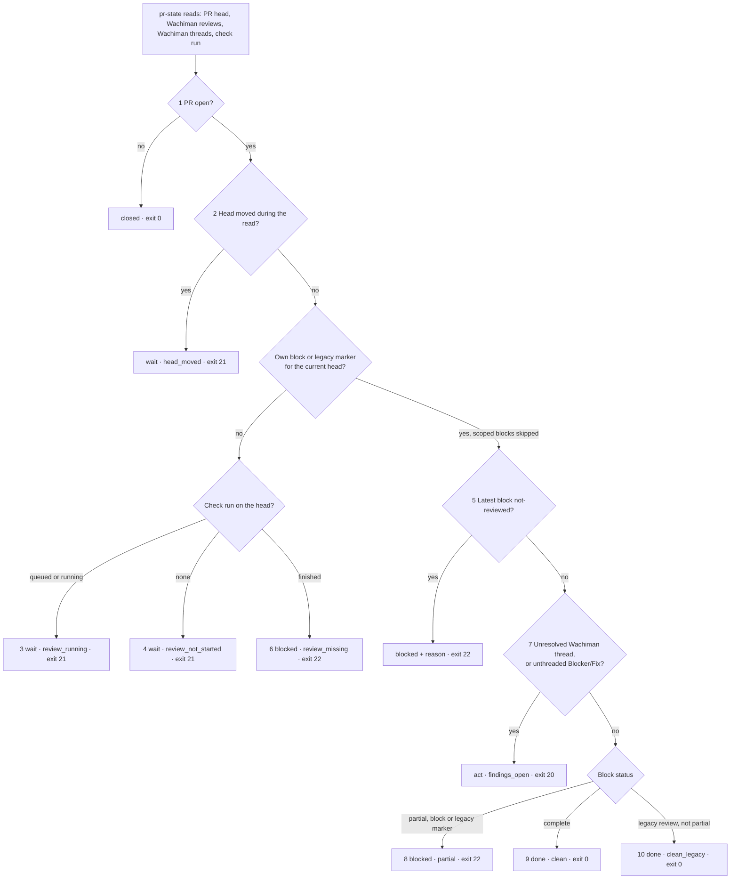

# A machine-readable review state and `wachiman pr-state`

- **Status:** proposed (2026-11-19); implemented by the pull request that adds it. Tracker: [NIW2-881](https://linear.app/niway/issue/NIW2-881/wachiman-a-machine-readable-review-state-and-wachiman-pr-state-so-any).
- **ADRs:** [the review state is one versioned block in the signed footer, and `pr-state` derives the next step from it](../adr/0060-the-review-state-is-one-versioned-block-in-the-signed-footer-and-pr-state-derives-the-next-step.md) (new; extends the signed-footer-only reading rule of [ADR 0036](../adr/0036-a-partial-review-records-the-files-it-did-not-reach-so-the-next-push-resumes.md) decision 1 to one more marker, and reuses the advisory posture of [ADR 0034](../adr/0034-a-review-loop-driven-by-the-cli-that-never-edits-code.md)).

## Summary (one minute)

A coding agent that works a pull request reviewed by Wachiman has to read prose and HTML comments
to learn three things: did Wachiman review the current head, was that review complete, partial or
refused, and which of its findings still wait for the author. Agents produce no standard output, so
every harness re-implements that reading, and it breaks when the comment layout moves. This spec
makes the engine publish its state as one versioned JSON block in the signed footer of every review
it posts, and adds `wachiman pr-state`, a read-only command that turns that block plus the pull
request's review threads into one JSON answer: `wait`, `act`, `blocked`, `done` or `closed`, with
fixed exit codes. It covers only Wachiman's own review. An optional `--wait` polls until the answer
is no longer `wait`.

<!-- visual: pr-state-flow -->



## What changes

| Thing | Today | After |
| --- | --- | --- |
| Review state on GitHub | Loose markers: `wachiman sha=` on reviews that covered a head, `wachi:partial` with an opaque state, `wachi:refusal`, `wachi:ceiling`, `wachi:limit`; notices carry no sha | Every review POST also carries `<!-- wachi:state <base64url JSON> -->` in the signed footer, schema `wachiman.review-state/1`, with head, attempt, engine version, status, reason and finding counts |
| Engine version on a review | Not in the footer | `engine` field of the state block |
| Why the headline count differs from the inline count | By design (info, pre-existing, off-diff findings have no thread), but only readable from prose | Counts per placement in the state block: `inline`, `body`, `outside_diff` |
| Asking "what does Wachiman need on this PR" | The agent reads comments, or a private script parses markers | `wachiman pr-state [<pr>] --json`, schema `wachiman.pr-state/1`, exit codes 0, 20, 21, 22 |
| Waiting for the review | The harness wakes the agent on any PR event, or the agent sleeps | Harness wake as today; `pr-state --wait` for agents without one |
| Parsing markers | Readers spread across `src/engine.ts` | One module, `src/review-state.ts`, writes and reads the block; existing readers keep their markers |
| Local store | History run files and loop state | Unchanged; `pr-state` adds no store |

## Decisions

| # | Decision | Why | ADR |
| --- | --- | --- | --- |
| 1 | Every review the engine POSTs carries one versioned state block in the signed footer, including notices | Notices (refusal, ceiling, limit, base update) carry no sha today, so "not reviewed, and why" is unreadable by code | 0060 (new) |
| 2 | The block counts only inside the signed footer of an own-author review, under the existing trust rule; model text is neutralised as today | A forged block in a finding or a PR description must never change the state | 0060, extends 0036 |
| 3 | The block lives beside today's markers for one minor release, then the engine's own readers move to it | The engine reads `wachiman sha=` and `wachi:partial` to pick re-review starting points; changing both at once is an avoidable risk | 0060 |
| 4 | `pr-state` covers Wachiman's own review and findings only; `done` means "Wachiman has nothing pending on this head" | The owner's scope; other bots, CI and conflicts have their own sources, and a `done` read as "ready to merge" would be wrong | 0060 |
| 5 | `pr-state` stores nothing; it derives every field from GitHub on each call | A local copy goes stale with every push from another machine and cannot be the authority on a thread | 0060 |
| 6 | `next` comes from a fixed, ordered rule table in code; the model is never asked | Determinism is the point of the command | 0060 |
| 7 | Exit codes 0 (done or closed), 20 (act), 21 (wait), 22 (blocked), 1 (GitHub error), 2 (usage); 20-22 are new | 3, 10, 11 and 130 already mean other things in the CLI | 0060 |
| 8 | `--wait` makes one state read per interval (one GraphQL query plus pagination and the head check), with a timeout that defaults under ten minutes; it may use `gh event listen` when that command exists and works, and always re-reads state after an event | `gh event listen` is a preview behind a waitlist, drops events during a disconnect and reports nothing that happened before it started | 0060 |
| 9 | `pr-state` never posts, resolves, replies or edits code | Same posture as the loop (ADR 0034) and thread authority (ADR 0008) | reuses 0034, 0008 |

## Layers

| # | What it builds | Criteria | Risk | Depends on |
| --- | --- | --- | --- | --- |
| 1 | `src/review-state.ts` (schema, writer, reader, size cap); the engine appends the block to every review POST; footer regex accepts it; fixtures | AC1, AC2, AC3, AC4, AC5, AC16 | 🟡 Medium | — |
| 2 | `wachiman pr-state [<pr>] [--repo] --json`, the rule table, exit codes, help page, `docs/cli.md` row, `docs/pr-state.md` reference with the schema, a line in the shipped skills telling agents to call it after a wake | AC6, AC7, AC8, AC9, AC10, AC11, AC12, AC17 | 🟡 Medium | 1 |
| 3 | `--wait`, `--timeout`, `--interval`; optional `gh event listen` acceleration | AC13, AC14, AC15 | 🟢 Low | 2 |

## Open questions

1. **Expose `pr-state` through the MCP server?** The MCP design (open design pull request) runs CLI
   commands as children. Default: not in this spec; the MCP layer can add it once both merge.
2. **Should the engine's own readers move to the block in the next minor release, or stay on the
   old markers indefinitely?** Default: move in the release after layer 1 ships, behind a test that
   both encodings decode to the same starting point.

## Out of scope

- Other reviewers (CodeRabbit and others), CI results other than the "Wachiman review" check run, merge conflicts, mergeability.
- Merging, approving, resolving threads, posting replies, editing code.
- A local database, cache or index of pull-request state.
- A listener service, webhook receiver or anything hosted.
- GitHub Enterprise Server; `--wait` acceleration on hosts without `gh event listen`.
- Reading `agent-review sha=` markers left by engine versions before the legacy window closed.
- A GitHub Actions job output with the state (possible later from the same module).

## Failures this must protect against

- The head moves while `pr-state` reads: it answers about a head that is no longer current.
- Two attempts on the same head (rerun, base update): the older block is read as the current one.
- A forged `wachi:state` block in model output, a file name or the PR description changes the answer.
- A review that never comes (workflow disabled, failed before posting, skipped by the size gate, no credit, ceiling reached) makes `--wait` hang, or is reported as `done`.
- "No findings" on a refused or partial review is read as clean.
- The block grows past what a review body can hold on a large review and breaks the post.
- A review from an engine version without the block is reported as `not-reviewed` instead of falling back to its sha and partial markers.
- More than 100 threads, or a thread with more than 100 comments (whose last author decides who the thread awaits), hides an unresolved Wachiman finding thread.
- An outdated but unresolved Wachiman thread disappears from the answer.
- `--wait` exceeds the GitHub rate limit or a harness's foreground time limit.
- An agent reads `done` as "ready to merge".
- A base-update line read as a refusal turns every rebased pull request `blocked`.
- Placement counts written before the 422 fallback moves inline comments into the body.
- A scoped review of a few paths read as a review of the whole head.
- A thread drops out of the answer because the author replied, and the pull request reads `done` with the thread still open.

## Acceptance criteria

- [ ] **AC1** Every review body the engine POSTs (full review, re-review, partial, base-update line, all-binary notice, refusal, ceiling, limit, and the turn-limit, call-timeout and budget notices that report nothing was reviewed) ends its signed footer with exactly one `<!-- wachi:state … -->` whose decoded JSON validates against `wachiman.review-state/1` (fake-GitHub tests per kind).
- [ ] **AC2** The block holds `format`, `engine`, `head`, `attempt`, `status` (`complete`, `partial`, `scoped`, `not-reviewed`), `reason` (required when `not-reviewed`: `billing`, `auth`, `rate_limit`, `ceiling`, `limit`, `size_gate`, `turn_limit`, `timeout`, `budget`), `carried_from` (the earlier head, on a base-update line, which is `complete` and repeats that head's counts), `scope` (`binary_only` on the all-binary notice, which is `complete` with zero findings; the path count on a scoped review), and `findings` counts by severity and by placement (`inline`, `body`, `outside_diff`) that add up to the headline count, and a separate `unthreaded_blocking`, the number of Blocker and Fix findings within `body` plus `outside_diff` (unit tests over fixtures, including the by-design gap between the headline and the inline count).
- [ ] **AC16** The block is built from the body actually posted: when GitHub refuses the inline comments and `moveCommentsToBody` moves them, the retried post carries a block with `inline: 0` and the moved findings counted under `body` (fake-GitHub test of the 422 fallback).
- [ ] **AC3** A `wachi:state` string in model output, a finding body, a file name or the PR description is neutralised and never read; a block outside the signed footer or from another author is ignored (tests reuse the forgery fixtures of the existing marker tests).
- [ ] **AC4** When the encoded block would exceed its cap, the engine keeps the counts and drops nothing else from the review; the post never fails because of the block (test with a synthetic large review).
- [ ] **AC5** The re-review starting point, ceiling sum, limit notice and refusal edit-in-place give the same results with and without the new block on the same fixtures (existing tests pass unchanged, plus one run with the block present).
- [ ] **AC6** `wachiman pr-state <pr> --json` prints one object that validates against `wachiman.pr-state/1`: `format`, `repo`, `pr`, `head`, `review` (`state`: `none`, `running`, `complete`, `partial`, `scoped`, `not-reviewed`, `stale`; `reason`; `reviewed_head`; `attempt`; `engine`; `source`: `block` or `legacy-markers`), `findings.open` (one entry per unresolved Wachiman finding thread, whoever wrote last: `thread_id`, `url`, `path`, `line`, `severity`, `outdated`, `awaiting`: `fix_or_reply` when Wachiman wrote the last comment, `resolve` when someone else did), `findings.unthreaded` (counts from the block), `next`, and `why` (a fixed code, not prose).
- [ ] **AC7** `next` follows the rule table in the spec's detail, in order, and the exit code matches it: `closed` and `done` exit 0, `act` 20, `wait` 21, `blocked` 22, a GitHub error 1, a usage error 2 (table-driven test over every row).
- [ ] **AC8** `done` with `why: clean` is returned only when the current head has a `complete` block and no Wachiman finding thread is unresolved, whoever wrote its last comment, and the block counts no Blocker or Fix finding outside a thread (`unthreaded_blocking` is 0); a `partial` or `not-reviewed` head never yields `done`; zero findings on a non-complete review yields `blocked` or `wait`, never `done`. The only other `done` is `clean_legacy` (AC11).
- [ ] **AC17** A `scoped` block never decides the head's state: `pr-state` skips it when choosing the head's block, and still lists its threads under `findings.open` (test: a scoped review on the current head after a complete review of an older head answers `wait` or `blocked`, not `done`).
- [ ] **AC9** If the PR head read at the end differs from the head read at the start, the answer is `wait` with `why: head_moved`.
- [ ] **AC10** With several own reviews on the same head, the block of the most recent attempt by creation time decides; a newer push makes every older block `stale`.
- [ ] **AC11** Reviews posted by an engine without the block are read from `wachiman sha=` and `wachi:partial` with `source: legacy-markers`; a legacy notice without a sha yields `review.state: none`, never `complete`. A legacy review of the current head has no counts, so `findings.unthreaded` is `null`, and with no unresolved Wachiman finding thread it yields `done` with `why: clean_legacy`, never `clean`.
- [ ] **AC12** Threads are read with pagination, and each thread's first and last comment are asked for by name, so an unresolved finding thread beyond the first 100 threads, or the last author of a thread with more than 100 comments, is reported (fake-GitHub test with 150 threads).
- [ ] **AC13** `pr-state --wait` returns as soon as `next` is not `wait`; on timeout it prints the last state with `why: timeout` and exits 21; the default timeout is under 10 minutes and the default interval at least 20 seconds.
- [ ] **AC14** `--wait` makes at most one state read per interval; an event from `gh event listen` only moves the next read earlier, never sooner than one interval after the last read. A read is one GraphQL query, plus extra pages only when there are more than 100 threads, plus the end-of-read head check of AC9; never two state reads within one interval, however many events arrive (counted in a fake-GitHub test).
- [ ] **AC15** When `gh event listen` is missing or fails, `--wait` falls back to polling and says so once on stderr; stdout stays a single JSON object.

---

## The rule table

`pr-state` evaluates these rows in order and stops at the first that matches. `why` is the fixed
code in the last column.

| # | Condition | `next` | Exit | `why` |
| --- | --- | --- | --- | --- |
| 1 | The PR is closed or merged | `closed` | 0 | `closed` |
| 2 | The head at the end of the read differs from the head at the start | `wait` | 21 | `head_moved` |
| 3 | No own review block or legacy marker for the current head, and the "Wachiman review" check run on the head is queued or in progress | `wait` | 21 | `review_running` |
| 4 | No own review for the current head and no check run on it | `wait` | 21 | `review_not_started` |
| 5 | The latest block for the head is `not-reviewed` | `blocked` | 22 | the block's `reason` |
| 6 | The check run on the head finished and no own review exists for it | `blocked` | 22 | `review_missing` |
| 7 | At least one Wachiman finding thread is unresolved, or the block counts Blocker or Fix findings outside a thread | `act` | 20 | `findings_open` |
| 8 | The block is `partial`, or a legacy review of the head carries `wachi:partial` | `blocked` | 22 | `partial` |
| 9 | The block is `complete` | `done` | 0 | `clean` |
| 10 | A legacy review (`wachiman sha=` for the head, no block, no `wachi:partial`) covers the head | `done` | 0 | `clean_legacy` |

"The latest block for the head" skips `scoped` blocks: a review an operator asked for on some
paths says nothing about the rest of the head. A base-update line counts as `complete` for its
head, because the engine carries the earlier review over (`carried_from`).

A Wachiman finding thread is one whose first comment carries `wachi:finding` from the own author.
Every unresolved one is listed under `findings.open` and keeps the answer at `act`, whoever wrote
its last comment. When Wachiman wrote last, `awaiting` is `fix_or_reply`: the agent fixes the code
or answers. When someone else wrote last, `awaiting` is `resolve`: the operator, or an agent acting
for them, resolves it or waits for Wachiman's automatic reply (ADR 0008 keeps resolving with the
operator). A thread never drops out of the answer because someone replied.

Unthreaded findings belong to the reviewed head. There is no thread to resolve for them: the agent
fixes the code and pushes, and the review of the new head decides. On the same head the answer
stays `act` with `why: findings_open`, so an agent that decides such a finding is not its to fix
stops and asks the operator instead of waiting.

When a rerun on the same head leaves two own blocks, the block of the most recent attempt by
creation time wins (AC10), so a rerun's block replaces the earlier one. A rerun that is refused or
partial therefore makes the head `blocked`, deliberately: the latest attempt is what the operator
asked for.

Row 4 answers `wait`, not `blocked`, because the workflow's push debounce can delay the check run.
`--wait` bounds it with its timeout; a caller without `--wait` decides how long to accept it.

## The state block

```json
{
  "format": "wachiman.review-state/1",
  "engine": "1.18.0",
  "head": "9f2c…",
  "attempt": "6b1e…",
  "status": "complete",
  "reason": null,
  "findings": {
    "total": 7,
    "by_severity": { "blocker": 0, "fix": 1, "consider": 4, "info": 2 },
    "by_placement": { "inline": 4, "body": 2, "outside_diff": 1 },
    "unthreaded_blocking": 0
  }
}
```

`unthreaded_blocking` counts the Blocker and Fix findings placed in the body or outside the diff, the placements that get no thread.
It is built last, from the body and inline comments actually sent: if GitHub refuses the inline
comments and the engine moves them into the body, the retried post carries a rebuilt block.
It is base64url-encoded so its content cannot close the HTML comment. It sits after the review
signature and before the attempt footer, so the signed-footer pattern grows by one optional line.
`partial` keeps the existing `wachi:partial` marker for the engine's own continuation logic; the
block only says `status: partial`. The block is never placed on inline comments, replies or issue
comments.

## Why this and not the alternatives

- **A listener or babysit service in Wachiman.** Harnesses already wake agents for free, and GitHub
  now ships `gh event listen`. What no harness can know is Wachiman's own state; that is the gap.
- **A local database of rounds.** It would duplicate GitHub, go stale on a push from another
  machine, and fragment between worktrees. The history files already keep what never reaches
  GitHub (local rounds, verdicts) and the loop keeps its rounds per branch.
- **Parsing today's markers only, without a block.** Notices carry no sha and no machine-readable
  reason, partial state is opaque, and the engine version is absent, so `blocked` versus `wait`
  versus `done` cannot be told apart reliably.
- **Reading the "N finding(s)" prose.** The headline count includes findings that have no thread by
  design; only counts by placement make the difference checkable.

## Evidence

**Rounds on this repository.** The 60 most recently merged pull requests here (2026-11-12 to
2026-11-19) had 20 with a signed Wachiman review: median 1 round, maximum 5. Round 1 averaged 4.15
findings; later rounds averaged under 1.

**Rounds on one private product repository**, counts only: 60 merged pull requests (2026-11-14 to
2026-11-19), 216 rounds, median 3 per PR, 14 PRs with 6 or more. Findings per round fell from a mean
of 3.2 in round 1 to 0.4 from round 4 on, and 30% of rounds were base-update lines with no findings.
The median time from push to review was 5.1 minutes (p90 12.2), and a round saw a median of 5
pull-request events (reviews and finished check suites), which is why a wake per event is noisy.

**Headline count against inline count.** Of the 15 most recent signed reviews here, 7 state a
headline count different from their inline comments; in all 14 that state "N on their lines", that
figure equals the inline comments. The gap is by design (info, pre-existing and off-diff findings
have no thread), and today only prose says so.

**Limits.** One owner's workflow. The private-repository sample ran an older engine for part of the
window. Push times are approximated from commit dates. None of this measures how many tokens an
agent saves; the case for the command is a deterministic contract, not cost.

## Weak points and answers

The claim was attacked by a model on another provider, given only the claim and the facts.

| Weak point | Answer |
| --- | --- |
| A sha marker cannot tell two attempts on the same head apart | The block carries the attempt id that the engine already writes; AC10 |
| Some waits have no verdict (skipped, refused, ceiling, failed) | `not-reviewed` with a reason, rows 5 and 6, `--wait` timeout; AC8, AC13 |
| A review-only answer does not cover CI or conflicts | Accepted by scope (decision 4); `done` is defined narrowly and documented |
| The saving might belong in harness event filtering | Accepted: this spec does not claim a token saving; harnesses keep waking agents |
| A local store diverges and has no authority on "fixed" | No store (decision 5) |
| Findings may be parsed from presentation text | Counts come from the block; threads are identified by `wachi:finding` and the own author, not by prose |
