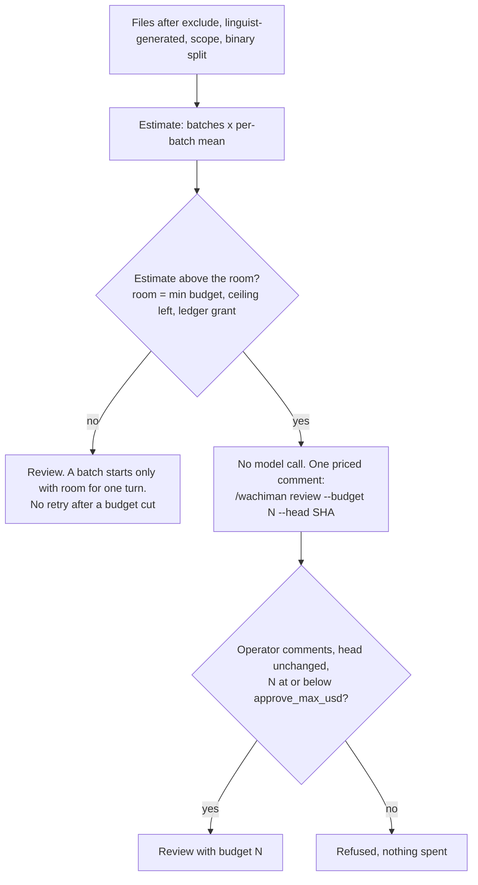

# Skip a review the run cannot pay for in full, and stop paying for calls that cannot work

- **Status:** proposed (2026-11-21). Tracker: [NIW2-910](https://linear.app/niway/issue/NIW2-910/wachiman-skip-a-review-the-run-cannot-pay-for-in-full-and-let-the).
- **ADRs:** [a review the run cannot pay for in full is skipped, and the operator approves a budget for one head](../adr/0062-a-review-the-run-cannot-pay-for-in-full-is-skipped-and-the-operator-approves-a-budget-for-one-head.md).

## Summary (one minute)

[Pull request 287](https://github.com/niway-dev/wachiman/pull/287) was estimated at $5.76 and
started anyway with a $3 budget, because the size gate ($6) is never below the run budget. It
[spent $3.15](https://github.com/niway-dev/wachiman/actions/runs/44953987894/job/136997919290),
reviewed 138 of 312 files, and four of its twelve calls produced nothing: three batches stopped
on their budget, two of them with less room than the floor this spec sets, and a batch cut by its
budget was retried. This spec makes the
room the gate: an estimate above what the run may spend makes no model call and posts the price
with a command only the operator can use to approve that head. It also stops the wasted calls,
makes the partial-review comment readable, and honours `linguist-generated` from the base commit.

<!-- visual: budget-gate-flow -->

## What changes

| Thing | Today | After |
| --- | --- | --- |
| Estimate between run budget and $6 | Partial review, paid in full | No model call; priced comment |
| Approving a larger review | Edit `budget_usd` in the workflow | `/wachiman review --budget N --head SHA`, operator only |
| `size_gate_usd` | Gate, never below the run budget | Accepted, ignored, logged as deprecated |
| Batch start floor | $0.05 of room | About 60% of the model's mean batch cost (Sonnet ≈ $0.19) |
| Retry after a budget cut | Retried with what is left | Never retried; files reported as not reached |
| Partial-review comment | Every unread file inline with its reason | Counts by reason on one line; the list in a collapsed block |
| `linguist-generated` / `linguist-vendored` | Reviewed | Excluded, read from the base commit's `.gitattributes` |

## Decisions

| # | Decision | Why | ADR |
| --- | --- | --- | --- |
| 1 | The gate is the room: `min(budget, ceiling left, ledger grant)` | A review the run cannot finish is known before the first call | 0062 (new), amends 0037 |
| 2 | Approval is `/wachiman review --budget N --head SHA`, operator only, capped by `approve_max_usd` ($20) | Same authority as today's `review` and `--force`; bound to one head | 0062 (new) |
| 3 | `size_gate_usd` deprecated, ignored, removed in the next major | With the room as the gate it is either equal or skips affordable reviews | 0062 (new) |
| 4 | No content filtering: formatting-only changes are reviewed | Owner's decision: a formatting change can still break something | 0062 (non-goal) |
| 5 | Batch floor = 0.6 × the model's per-batch mean, never below $0.05 | The cheapest first turn on pull request 287 cost $0.17; $0.05 buys nothing | — |
| 6 | A batch whose call ended on its budget is not retried | The retry meets the same limit with less room | — |
| 7 | Partial comment: one count line, list collapsed; hidden marker unchanged | The 312-file comment was unreadable; ADR 0036's marker is not touched | reuses 0036 |
| 8 | `linguist-generated` and `linguist-vendored` from the base commit exclude a file | The owner's own marker, like `exclude`; base so a pull request cannot mark itself | reuses 0058's base-commit rule |
| 9 | Release: `release: direct` for each layer, with a changelog line for the behaviour change | No flag: the old partial path is the defect | — |

## Layers

| # | What it builds | Criteria | Risk | Depends on |
| --- | --- | --- | --- | --- |
| 1 | Batch floor, no retry after a budget cut, readable partial comment | AC1, AC2, AC3 | 🟢 Low | — |
| 2 | Room as the gate, priced comment, `--budget N --head SHA`, `approve_max_usd`, `size_gate_usd` deprecation, local warning threshold, docs | AC4–AC10, AC13–AC15 | 🟡 Medium | — |
| 3 | `linguist-generated` / `linguist-vendored` exclusion from the base commit | AC11, AC12 | 🟢 Low | — |

## Open questions

- None blocking. Defaults taken where the owner did not answer: `approve_max_usd` $20, floor 0.6 ×
  per-batch mean, pull request 287 waits for the release and is then reviewed with `/wachiman review`.

## Out of scope

- Filtering or grouping formatting-only, whitespace or syntax-equivalent changes.
- Approval by anyone other than the operator.
- Local mode (`wachiman local` keeps warning and continuing, ADR 0037 decision 10).
- Any change to budget defaults, the per-batch figures, or the ledger.

## Failures this must protect against

- A collaborator who is not the operator comments `--budget 50`: ignored as today, nothing is spent.
- An estimate above `approve_max_usd`: the comment offers no command that would be skipped again.
- A skip caused by the ledger grant: the comment points at the ledger and `--force`, not at `--budget`.
- The operator approves head A, a push makes the head B before the job starts: the run refuses.
- A GitHub rerun of the approved job on a completely reviewed head: nothing is spent twice.
- `--budget` with `0`, a negative number, `NaN`, `Infinity`, or a value above `approve_max_usd`: refused with a reply that says why.
- `--budget` and `--head` words leak into the path list of `/wachiman review <paths>`.
- An automatic run with $5.50 of the $6 ceiling spent and a $2 estimate: skipped (room $0.50), not started.
- A ledger that grants less than the estimate after the gate passed: no call, $0.00 settled, a comment naming the grant and `--force`.
- `--budget 8` without `--head`, `--head <sha>` without `--budget`, `--budget` as the last word, `--budget=8`: refused with one reply, never read as paths.
- `verify` on: the reserves are subtracted from the room, so an approved `N` still leaves the batches what the estimate needs.
- An automatic run whose ceiling is spent: today's pause notice, not the priced comment.
- A pull request edits `.gitattributes` to mark its own files as generated: ignored, the base commit's file applies.
- A batch with room below the floor while other batches run: it waits for room, and is reported as not reached only when none comes back.

## Acceptance criteria

- [ ] **AC1** A batch never starts with room below `0.6 × per-batch mean` for the model (floor $0.05); a fake-provider test with $0.06 left shows no call and the files reported as not reached. (On pull request 287 this removes batches 10 and 11; batch 8 started with $0.24 and would still run.)
- [ ] **AC2** A batch whose call ended on its budget is not retried; a fake test shows one call, not two, and the unaccounted files reported as "the call ran out of its budget".
- [ ] **AC3** The partial-review comment's first line has the reviewed count and the not-reviewed count by reason; the file list is inside a `
` block; the hidden marker of ADR 0036 is byte-identical to today's for the same input.
- [ ] **AC4** An automatic run whose estimate is above `min(budget_usd, ceiling left)` makes no model call and posts or edits the one size-gate comment; a fake test with pull request 287's numbers ($5.76 vs $3) passes.
- [ ] **AC5** The comment states the estimate, the room, the short head SHA and the "may pass by about one call" note. When the run budget is the smallest term, it gives the command with `N = ceil(1.5 × estimate)` plus the reserves if `N ≤ approve_max_usd`, and otherwise no command but the instruction to raise `approve_max_usd` or review paths. The ceiling case is AC15 and the ledger case is AC14.
- [ ] **AC6** `/wachiman review --budget N --head SHA` from the operator, with the current head and a valid `N`, runs with budget `N`; the run's footer names the approved budget.
- [ ] **AC7** From the operator, a stale head, an invalid or too-large `N`, `--budget` without `--head` or the reverse, a missing value, or `--budget=N` makes no model call and replies once with the reason; none of these words is read as a path. From anyone else the command is ignored as today: no call, no reply.
- [ ] **AC8** A rerun of an approved job on a head whose review is complete spends nothing; after a partial review it resumes the unread files within `N`.
- [ ] **AC9** `size_gate_usd` set in a caller still validates; the run logs one deprecation line and the value has no effect on the gate.
- [ ] **AC10** Every doc and template that mentions the size gate describes the room gate and the approval command: `docs/costs.md`, `docs/configuration.md`, `docs/review-policy.md`, `docs/faq.md`, `docs/setup-copy.md`, `docs/cli.md`, `docs/troubleshooting.md`, `docs/local-review.md`, `docs/pr-state.md`, `templates/caller-workflow.yml`, `templates/wachiman-review-caller.yml`. `grep -ri "never below" docs templates` finds no gate rule.
- [ ] **AC11** Files with `linguist-generated` or `linguist-vendored` set by the base commit's `.gitattributes` are excluded before the estimate, with one `git check-attr --source=<base> --stdin -z` call per run.
- [ ] **AC12** A pull request that adds `linguist-generated` for its own files in `.gitattributes` still has them reviewed.
- [ ] **AC13** `wachiman local` warns when the estimate is above `budget_usd` and continues; `size_gate_usd` has no effect on the warning.
- [ ] **AC14** When the ledger grants less than the estimate after the gate passed, `review` makes no model call, settles $0.00, and the comment names the grant and `--force`, not `--budget`.
- [ ] **AC15** When only the ceiling is short and `budget_usd` covers the estimate, the comment offers plain `/wachiman review`; with `verify` on, the room and `N` include the reserves.

---

## Detail

### Where the room is known

The size gate runs today before `ceilingRoom` and `spendReserve` (`src/engine.ts`, the block that
calls `sizeGate`). Layer 2 moves the comparison after the ceiling is read and compares again after
the ledger grant: `totalBudget = min(budget, ceiling.room, grant.roomUsd)` is already computed
there. The comparison uses what the batches get, `totalBudget` minus the verifier and
memory-matching reserves that `reviewChange` takes first. A skip after a reservation settles it
with $0.00; `review` has no such check today (`grantTooSmall` serves thread replies and answers
only), so this is new behaviour with its own criterion, AC14.

### Parsing the approval

`parseCommand` returns every word after `review` as a path and reads `--force` from them. Layer 2
adds `--budget <n>` and `--head <sha>` the same way and removes both words and their values from
`paths`. `--head` matches when it is a prefix of at least 7 characters of the current head.

### The partial comment

The visible line becomes, for pull request 287: "Reviewed 138 of 312 files. Not reviewed: 174 (103
not reached: the pull request's budget was spent; 71 not reached: the call ran out of its budget)."
These are the counts in the review posted on that pull request.
The per-file list follows in `

Files not reviewed
`, grouped by reason.
The hidden marker that ADR 0036 caps at 10,000 characters is built separately and does not change.

### Evidence

- Run log of pull request 287: twelve calls, $3.150325 total; batches 8, 10 and 11 started with
  $0.24, $0.18 and $0.06 of room and stopped on their budget at $0.26, $0.25 and $0.27; the retry
  of batch 11 cost $0.27 and produced nothing.
- `MIN_BATCH_USD = 0.05` in `src/engine.ts`, and the retry condition there: every batch with gaps
  is retried except after a timeout or its own refusal, so a budget cut is retried.
